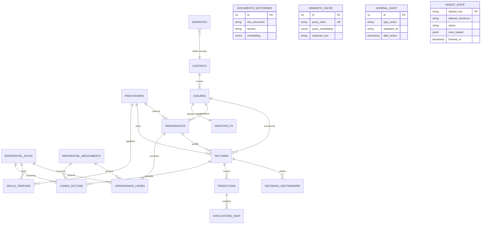

# Cadrage et Contrats d'Interface – PrediCare TPA

Ce document constitue la référence contractuelle unique, exhaustive et définitive entre le pôle Data / ML (M1), le pôle Backend / Plateforme (M2) et le pôle Produit / Front / RAG (M3). Il fige l'architecture logicielle, le schéma physique (ERD), les règles de sécurité (RBAC), les formats d'échange et l'ensemble des contrats d'API nécessaires au fonctionnement et à l'exploitation de la plateforme.

---

## 1. Rôles et Matrice d'Accès (RBAC)

La plateforme applique un contrôle d'accès strict par rôle. Chaque requête authentifiée transmet le token JWT dans l'en-tête standard : `Authorization: Bearer <token_jwt>`. Le payload contient au minimum `sub` (identifiant utilisateur) et `role` :

| Rôle | Périmètre et Droits Métier |
| --- | --- |
| `assure` | Consulte ses propres dossiers de remboursement, son profil et interroge l'assistant RAG (restreint strictement à ses contrats/garanties et son historique de soins). |
| `professionnel_sante` | Télétransmet de nouvelles factures de soins pour prise en charge et suit l'état de traitement de ses règlements. |
| `gestionnaire` | Instruit les dossiers, analyse les scores de fraude et les explications SHAP, enregistre les arbitrages et consulte les KPIs opérationnels. |
| `administrateur` | Configure les seuils d'alerte en direct, gère les versions du modèle (rollback), supervise les métriques/dérive et consulte les journaux d'audit. |

### Matrice détaillée des permissions par endpoint (RBAC) :

| Méthode & Endpoint | Description | `assure` | `professionnel_sante` | `gestionnaire` | `administrateur` |
| --- | --- | :---: | :---: | :---: | :---: |
| `GET /health` | État et connectivité système | ✅ Public | ✅ Public | ✅ Public | ✅ Public |
| `POST /auth/login` | Connexion et émission du JWT | ✅ Public | ✅ Public | ✅ Public | ✅ Public |
| `GET /auth/me` | Récupération du profil connecté | ✅ | ✅ | ✅ | ✅ |
| `GET /claims` | Liste paginée des factures | ✅ *(ses dossiers)* | ✅ *(ses télétransmissions)* | ✅ *(tous)* | ✅ *(tous)* |
| `GET /claims/{id}` | Détail complet d'une facture | ✅ *(si titulaire)* | ✅ *(si émetteur)* | ✅ | ✅ |
| `POST /claims` | Télétransmission / création facture | ❌ | ✅ | ❌ | ✅ |
| `GET /claims/{id}/prediction` | Score de risque ML et SHAP | ❌ | ❌ | ✅ | ✅ |
| `POST /claims/{id}/decision` | Arbitrage (valider/rejeter) | ❌ | ❌ | ✅ | ✅ |
| `GET /dashboard/kpis` | Indicateurs de pilotage et volumes | ❌ | ❌ | ✅ | ✅ |
| `POST /assistant/chat` | Assistant conversationnel RAG | ✅ *(restreint)* | ❌ | ✅ *(global)* | ✅ *(global)* |
| `GET /admin/config` | Consultation des seuils d'alerte | ❌ | ❌ | ❌ | ✅ |
| `PUT /admin/config` | Modification à chaud des seuils | ❌ | ❌ | ❌ | ✅ |
| `GET /admin/models` | Liste des modèles de fraude | ❌ | ❌ | ❌ | ✅ |
| `POST /admin/models/{id}/activate` | Bascule / Rollback du modèle | ❌ | ❌ | ❌ | ✅ |
| `GET /admin/metrics` | Supervision latence et dérive PSI | ❌ | ❌ | ❌ | ✅ |
| `GET /admin/audit` | Journaux d'audit et traçabilité | ❌ | ❌ | ❌ | ✅ |

---

## 2. Schéma Entité-Relation (ERD)

Le schéma physique PostgreSQL (géré par les migrations versionnées Alembic) comprend 21 tables articulées en 3 domaines :



### Règles structurelles strictes :
1. **Montants** : Toujours des entiers en ariary (`BIGINT`), sans décimales.
2. **Isolation PII** : Les données nominatives (nom, prénom, date naissance, téléphone, email, adresse, numéro CIN) sont isolées dans `identites_pii`, chiffrées avec `pgcrypto` (`PII_ENCRYPTION_KEY`). Seul `assure_id` circule dans le reste du système.
3. **Statuts des factures** : Uniquement les trois valeurs fermées réelles : `'PAYEE'`, `'REJETEE'`, `'EN_COURS'`.
4. **Fuite de données ML** : Les colonnes `statut`, `motif_rejet`, `montant_pris_en_charge` et `date_traitement` sont strictement exclues de l'entraînement et de l'inférence.

---

## 3. Contrats d'API (Endpoints)

Tous les échanges s'effectuent en JSON (`Content-Type: application/json`).
Format des dates : `YYYY-MM-DD`. Format des timestamps : `YYYY-MM-DDTHH:MM:SSZ` (ISO 8601).

---

### 3.1. Supervision & Santé

#### `GET /health`
Vérification de l'état de l'API et de la connectivité avec PostgreSQL.
- **Accès** : Public (non authentifié).
- **Réponse (200 OK)** :
```json
{
  "status": "ok",
  "version": "0.1.0",
  "database": "connected"
}
```
- **Réponse (503 Service Unavailable)** :
```json
{
  "status": "unhealthy",
  "version": "0.1.0",
  "database": "disconnected",
  "detail": "Impossible de joindre PostgreSQL"
}
```

---

### 3.2. Authentification & Profil

#### `POST /auth/login`
Authentification universelle par identifiant (`identifier` : username, `assure_id` ou `prestataire_id`) et mot de passe.
- **Accès** : Public.
- **Corps de la requête** :
```json
{
  "identifier": "gestionnaire1",
  "password": "MotDePasseSecurise123!"
}
```
- **Réponse (200 OK)** :
```json
{
  "access_token": "eyJhbGciOiJIUzI1NiIsInR5cCI6IkpXVCJ9...",
  "token_type": "bearer",
  "expires_in": 3600,
  "user": {
    "id": "USR-0012",
    "identifier": "gestionnaire1",
    "role": "gestionnaire",
    "nom_complet": "Aina Razafy"
  }
}
```
- **Erreurs** : `401 Unauthorized` si identifiants erronés.

#### `GET /auth/me`
Permet au Front React de réhydrater la session utilisateur au rafraîchissement de la page (F5) sans ressaisir les identifiants.
- **Accès** : Tout utilisateur authentifié.
- **En-tête** : `Authorization: Bearer <token_jwt>`
- **Réponse (200 OK)** :
```json
{
  "id": "USR-0012",
  "identifier": "gestionnaire1",
  "role": "gestionnaire",
  "nom_complet": "Aina Razafy"
}
```
- **Erreurs** : `401 Unauthorized` si token expiré ou manquant.

---

### 3.3. Gestion des Factures & Télétransmissions

#### `GET /claims`
Recherche et liste paginée des factures. Filtre automatique selon le rôle de l'utilisateur connecté (un assuré ne voit que ses dossiers, un prestataire ne voit que ses télétransmissions).
- **Accès** : `assure`, `professionnel_sante`, `gestionnaire`, `administrateur`.
- **Query Parameters** :
  - `page` (int, défaut 1)
  - `page_size` (int, défaut 20, max 100)
  - `statut` (string optionnel : `'EN_COURS'`, `'PAYEE'`, `'REJETEE'`)
  - `date_debut` / `date_fin` (string `YYYY-MM-DD` optionnel)
  - `fraud_alert_only` (bool optionnel, réservé gestionnaire/admin)
- **Réponse (200 OK)** :
```json
{
  "total": 142,
  "page": 1,
  "page_size": 20,
  "items": [
    {
      "facture_id": "FAC-00005637",
      "numero_facture": "F-2025-00124",
      "assure_id": "ASS-00421",
      "prestataire_id": "PR-0015",
      "date_soin": "2025-04-12",
      "date_emission": "2025-04-13",
      "montant_total": 45000,
      "part_assure": 9000,
      "montant_demande": 36000,
      "statut": "EN_COURS",
      "score_fraude": 0.87,
      "est_anomalie": true
    }
  ]
}
```

#### `GET /claims/{id}`
Détail complet d'une facture, incluant ses lignes d'actes/médicaments et l'ordonnance justificative éventuelle.
- **Accès** : `assure` (si titulaire), `professionnel_sante` (si émetteur), `gestionnaire`, `administrateur`.
- **Réponse (200 OK)** :
```json
{
  "facture_id": "FAC-00005637",
  "numero_facture": "F-2025-00124",
  "assure_id": "ASS-00421",
  "prestataire_id": "PR-0015",
  "nom_etablissement": "Clinique Saint-Paul",
  "ordonnance_id": "ORD-0003289",
  "date_soin": "2025-04-12",
  "date_emission": "2025-04-13",
  "montant_total": 45000,
  "part_assure": 9000,
  "montant_demande": 36000,
  "statut": "EN_COURS",
  "motif_rejet": null,
  "montant_pris_en_charge": null,
  "lignes": [
    {
      "num_ligne": 1,
      "code": "ACT-CS-01",
      "type_ligne": "ACTE",
      "quantite": 1,
      "prix_unitaire": 30000,
      "montant_total": 30000
    },
    {
      "num_ligne": 2,
      "code": "MED-CIP-0045",
      "type_ligne": "MEDICAMENT",
      "quantite": 2,
      "prix_unitaire": 7500,
      "montant_total": 15000
    }
  ]
}
```
- **Erreurs** : `404 Not Found` si inexistante, `403 Forbidden` si non autorisé.

#### `POST /claims`
Soumission d'une nouvelle facture (télétransmission). L'API FastAPI valide la conformité du bordereau, enregistre la transaction, déclenche l'inférence ML temps réel, et alerte n8n si le score dépasse le seuil configuré.
- **Accès** : `professionnel_sante`, `administrateur`.
- **Corps de la requête** :
```json
{
  "numero_facture": "F-2026-09871",
  "assure_id": "ASS-00421",
  "prestataire_id": "PR-0015",
  "ordonnance_id": "ORD-0003289",
  "date_soin": "2026-10-14",
  "date_emission": "2026-10-15",
  "montant_total": 45000,
  "part_assure": 9000,
  "lignes": [
    {
      "num_ligne": 1,
      "code": "ACT-CS-01",
      "type_ligne": "ACTE",
      "quantite": 1,
      "prix_unitaire": 30000,
      "montant_total": 30000
    },
    {
      "num_ligne": 2,
      "code": "MED-CIP-0045",
      "type_ligne": "MEDICAMENT",
      "quantite": 2,
      "prix_unitaire": 7500,
      "montant_total": 15000
    }
  ]
}
```
- **Réponse (201 Created)** :
```json
{
  "facture_id": "FAC-00084700",
  "statut": "EN_COURS",
  "score_fraude": 0.88,
  "est_anomalie": true,
  "seuil_applique": 0.80,
  "message": "Facture enregistrée. Alerte d'anomalie transmise au gestionnaire."
}
```
- **Erreurs** : `422 Unprocessable Entity` si montants incohérents ou code référentiel inconnu.

---

### 3.4. Détection de Fraude & Arbitrage Métier

#### `GET /claims/{id}/prediction`
Consulte l'évaluation prédictive et le rapport d'explicabilité SHAP généré pour une facture donnée.
- **Accès** : `gestionnaire`, `administrateur`.
- **Réponse (200 OK)** :
```json
{
  "facture_id": "FAC-00005637",
  "prediction": {
    "score_fraude": 0.87,
    "seuil_applique": 0.80,
    "est_anomalie": true,
    "version_modele": "v1.0.0-xgb",
    "date_prediction": "2026-10-14T08:32:00Z"
  },
  "explicabilite": {
    "top_facteurs": [
      {
        "feature": "ecart_tarif_conventionne",
        "valeur": 15000,
        "impact_shap": 0.38,
        "description": "Tarif facturé supérieur de 50 % au barème de référence"
      },
      {
        "feature": "jour_fermeture_etablissement",
        "valeur": 1,
        "impact_shap": 0.25,
        "description": "Acte réalisé un jour de fermeture hebdomadaire"
      }
    ],
    "recommandation": "Contrôle requis : anomalie tarifaire et temporelle détectée."
  }
}
```

#### `POST /claims/{id}/decision`
Enregistre l'arbitrage humain du gestionnaire sur un dossier suspect (alimente `decisions_gestionnaire` et met à jour le statut de la facture).
- **Accès** : `gestionnaire`, `administrateur`.
- **Corps de la requête** :
```json
{
  "decision": "REJETE",
  "motif": "Dépassement tarifaire non conventionné et acte hors jour d'ouverture",
  "montant_accorde": 0
}
```
*(Valeurs permises pour `decision` : `'VALIDE'`, `'REJETE'`, `'INVESTIGATION'`)*
- **Réponse (200 OK)** :
```json
{
  "facture_id": "FAC-00005637",
  "statut": "REJETEE",
  "decision": "REJETE",
  "gestionnaire_id": "USR-0012",
  "date_decision": "2026-10-15T10:15:00Z",
  "message": "Décision enregistrée avec succès."
}
```

---

### 3.5. Tableau de Bord Décisionnel & FinOps

#### `GET /dashboard/kpis`
Fournit l'ensemble des indicateurs de pilotage métier, volumétrie, fraudes évitées et distribution des anomalies.
- **Accès** : `gestionnaire`, `administrateur`.
- **Query Parameters** : `periode` (`'7d'`, `'30d'`, `'all'`)
- **Réponse (200 OK)** :
```json
{
  "periode": "30d",
  "kpis": {
    "total_factures_traitees": 15420,
    "montant_total_demande": 456200000,
    "montant_economise_fraude": 38400000,
    "taux_detection_fraude": 0.084,
    "dossiers_en_attente_arbitrage": 18
  },
  "distribution_fraudes": [
    {"type": "TARIF_ABUSIF", "count": 64},
    {"type": "ACTE_FICTIF", "count": 32},
    {"type": "DOUBLON", "count": 18},
    {"type": "PRESCRIPTION_NON_CONFORME", "count": 12}
  ]
}
```

---

### 3.6. Assistant RAG Sécurisé & Agentique

#### `POST /assistant/chat`
Interroge l'agent conversationnel ReAct combinant la recherche documentaire vectorielle (`pgvector`) et les requêtes SQL sécurisées (en lecture seule et restreintes à l'utilisateur connecté).
- **Accès** : `assure`, `gestionnaire`, `administrateur`.
- **Corps de la requête** :
```json
{
  "message": "Quel est le plafond de remboursement pour un détartrage avec ma formule ?",
  "conversation_id": "conv-4a8f9b2"
}
```
- **Réponse (200 OK)** :
```json
{
  "response": "Selon l'article 5 des Conditions Générales de votre formule CONFORT, les soins dentaires de prévention (dont le détartrage) sont pris en charge à 80 % dans la limite d'un plafond annuel de 80 000 Ariary.",
  "sources": [
    {
      "document": "Conditions_Generales_CONFORT.pdf",
      "section": "Article 5.1 - Soins dentaires",
      "page": 4
    }
  ],
  "provenance_cache_semantique": false
}
```

---

### 3.7. Administration, MLOps & Exploitation (CDC §2)

#### `GET /admin/config`
Récupère les paramètres opérationnels modifiables sans toucher au code.
- **Accès** : `administrateur`.
- **Réponse (200 OK)** :
```json
{
  "fraud_score_threshold": 0.80,
  "n8n_webhook_url": "http://n8n:5678/webhook/fraud-alert",
  "semantic_cache_enabled": true,
  "semantic_cache_threshold": 0.85
}
```

#### `PUT /admin/config`
Modifie les paramètres à chaud sans redémarrer le conteneur ni toucher au code (exigence CDC §2).
- **Accès** : `administrateur`.
- **Corps de la requête** :
```json
{
  "fraud_score_threshold": 0.75,
  "semantic_cache_threshold": 0.88
}
```
- **Réponse (200 OK)** :
```json
{
  "fraud_score_threshold": 0.75,
  "n8n_webhook_url": "http://n8n:5678/webhook/fraud-alert",
  "semantic_cache_enabled": true,
  "semantic_cache_threshold": 0.88,
  "updated_at": "2026-10-15T10:45:00Z"
}
```

#### `GET /admin/models`
Liste les versions de modèles disponibles sur le système pour audit et retour arrière.
- **Accès** : `administrateur`.
- **Réponse (200 OK)** :
```json
{
  "active_version": "v1.0.0-xgb",
  "available_models": [
    {
      "version_id": "v1.0.0-xgb",
      "type": "XGBoost",
      "recall_test": 0.912,
      "precision_test": 0.843,
      "f1_score": 0.876,
      "date_entrainement": "2026-10-14",
      "statut": "ACTIVE"
    },
    {
      "version_id": "v0.9.0-baseline",
      "type": "RandomForest",
      "recall_test": 0.835,
      "precision_test": 0.791,
      "f1_score": 0.812,
      "date_entrainement": "2026-10-13",
      "statut": "STANDBY"
    }
  ]
}
```

#### `POST /admin/models/{version_id}/activate`
Exigence CDC §2 : bascule immédiate vers une version précédente du modèle sans interruption de service (vérifiée en direct par le jury).
- **Accès** : `administrateur`.
- **Réponse (200 OK)** :
```json
{
  "message": "Bascule effectuée avec succès.",
  "active_version": "v0.9.0-baseline",
  "switched_at": "2026-10-15T11:00:00Z"
}
```

#### `GET /admin/metrics`
Exigence CDC §2 : supervision de l'API et suivi de la dérive statistique du modèle de fraude.
- **Accès** : `administrateur`.
- **Réponse (200 OK)** :
```json
{
  "api_metrics": {
    "requests_total": 45120,
    "error_rate_5xx": 0.0012,
    "p95_latency_ms": 142.5
  },
  "ml_drift_monitoring": {
    "metric": "PSI",
    "psi_score": 0.042,
    "statut_derive": "STABLE",
    "alerte_derive": false,
    "derniere_evaluation": "2026-10-15T00:00:00Z"
  }
}
```
*(Interprétation PSI : `< 0.10` Stable, `0.10 - 0.25` Dérive modérée, `> 0.25` Dérive critique)*

#### `GET /admin/audit`
Consulte les journaux d'audit de la table `journal_audit` pour conformité RGPD et sécurité.
- **Accès** : `administrateur`.
- **Query Parameters** : `page` (défaut 1), `page_size` (défaut 50), `type_action` optionnel.
- **Réponse (200 OK)** :
```json
{
  "total": 3120,
  "items": [
    {
      "id": 154,
      "type_action": "DECISION_FRAUDE",
      "utilisateur_id": "USR-0012",
      "role_utilisateur": "gestionnaire",
      "ressource_type": "facture",
      "ressource_id": "FAC-00005637",
      "details": {"decision": "REJETE", "motif": "Dépassement tarifaire"},
      "ip_source": "172.18.0.1",
      "date_action": "2026-10-15T10:15:00Z"
    }
  ]
}
```

---

## 4. Format d'Échange avec le Webhook n8n (Alerte Fraude)

Quand l'API FastAPI traite une facture dont le score de fraude dépasse `fraud_score_threshold` (0.80), elle effectue une requête HTTP `POST` vers l'URL configurée dans `n8n_webhook_url` :

- **Méthode** : `POST`
- **URL cible** : `http://n8n:5678/webhook/fraud-alert`
- **Payload JSON transmis** :
```json
{
  "event": "FRAUD_ALERT",
  "timestamp": "2026-10-15T10:14:32Z",
  "facture": {
    "facture_id": "FAC-00005637",
    "numero_facture": "F-2025-00124",
    "date_soin": "2025-04-12",
    "montant_total": 45000,
    "montant_demande": 36000,
    "prestataire_id": "PR-0015",
    "assure_id": "ASS-00421"
  },
  "prediction": {
    "score_fraude": 0.87,
    "seuil_applique": 0.80,
    "version_modele": "v1.0.0-xgb"
  },
  "explicabilite_shap": {
    "facteur_principal": "ecart_tarif_conventionne (+50 %)",
    "facteur_secondaire": "jour_fermeture_etablissement (Dimanche)"
  },
  "liens_action": {
    "dashboard_url": "http://localhost:3000/claims/FAC-00005637"
  }
}
```

Le workflow n8n reçoit ce JSON et déclenche automatiquement l'envoi d'une alerte formatée vers Slack et par email au gestionnaire.
