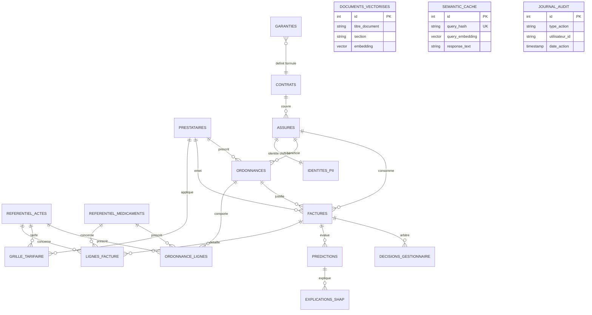

# Cadrage et Contrats d'Interface – PrediCare TPA

Ce document constitue la référence contractuelle unique entre le pôle Data / ML (M1), le pôle Backend / Plateforme (M2) et le pôle Produit / Front / RAG (M3). Il fige le schéma de données physique (ERD), les règles d'authentification et les contrats d'API afin de permettre des développements découplés et sans régression.

---

## 1. Rôles et Matrice d'Accès (RBAC)

La plateforme gère 4 rôles d'utilisateurs distincts. Les permissions sont contrôlées côté API FastAPI à chaque requête via le token JWT :

| Rôle | Périmètre et Droits | Endpoints autorisés |
| --- | --- | --- |
| `assure` | Consulte ses propres factures, son profil et pose des questions à l'assistant RAG (portant sur ses garanties et son historique). | `POST /auth/login`, `GET /claims` (filtré sur son `assure_id`), `POST /assistant/chat`, `GET /health` |
| `professionnel_sante` | Soumet de nouvelles factures / télétransmissions pour prise en charge et consulte l'état de ses télétransmissions. | `POST /auth/login`, `GET /claims` (filtré sur son `prestataire_id`), `POST /claims`, `GET /health` |
| `gestionnaire` | Instruit les dossiers, consulte les alertes de fraude, les scores ML, les explications SHAP et enregistre les décisions d'arbitrage. | Tous les endpoints sauf configuration système (`/admin`). Accès complet à `/claims`, `/claims/{id}/prediction`, `/dashboard/kpis`. |
| `administrateur` | Gestion des seuils d'alerte, supervision de la plateforme, consultation des journaux d'audit et métriques système. | Accès global à tous les endpoints. |

---

## 2. Schéma Entité-Relation (ERD)

Le schéma physique PostgreSQL comprend 18 tables réparties en 3 domaines :



### Règles structurelles clés :
- **Montants** : Stockés sous forme d'entiers en ariary (`BIGINT`), aucune décimale.
- **Isolation PII** : Noms, prénoms, CIN et coordonnées sont isolés dans `identites_pii` chiffrée avec `pgcrypto` (`PII_ENCRYPTION_KEY`). Seul `assure_id` circule dans le reste du système.
- **Intégrité factures** : `(facture_id, num_ligne)` est la clé primaire composite de `lignes_facture`.

---

## 3. Contrats d'API (Endpoints pivots)

Tous les échanges de données s'effectuent au format JSON (`Content-Type: application/json`).
L'authentification s'appuie sur le standard OAuth2 Bearer Token : `Authorization: Bearer <token_jwt>`.

### 3.1. `GET /health` (Supervision)
- **Authentification** : Aucune (public pour orchestrateur Docker / healthchecks).
- **Réponse (200 OK)** :
```json
{
  "status": "ok",
  "version": "0.1.0",
  "database": "connected"
}
```

---

### 3.2. `POST /auth/login` (Authentification)
- **Authentification** : Aucune.
- **Requête** :
```json
{
  "username": "gestionnaire1",
  "password": "MotDePasseSecurise123!"
}
```
- **Réponse (200 OK)** :
```json
{
  "access_token": "eyJhbGciOiJIUzI1NiIsInR5cCI...",
  "token_type": "bearer",
  "expires_in": 3600,
  "user": {
    "id": "USR-0012",
    "username": "gestionnaire1",
    "role": "gestionnaire",
    "nom_complet": "Aina Razafy"
  }
}
```
- **Erreurs** : `401 Unauthorized` si identifiants invalides.

---

### 3.3. `GET /claims` (Liste et filtrage des factures)
- **Rôles autorisés** : `assure`, `professionnel_sante`, `gestionnaire`, `administrateur`.
- **Filtres (Query params)** : `page`, `page_size`, `statut` (`PAYEE`, `REJETEE`, `EN_COURS`), `date_debut`, `date_fin`, `fraud_alert_only` (bool).
- **Réponse (200 OK)** :
```json
{
  "total": 142,
  "page": 1,
  "page_size": 20,
  "items": [
    {
      "facture_id": "FAC-00005637",
      "numero_facture": "F-2025-00124",
      "assure_id": "ASS-00421",
      "prestataire_id": "PR-0015",
      "date_soin": "2025-04-12",
      "montant_total": 45000,
      "part_assure": 9000,
      "statut": "EN_COURS",
      "score_fraude": 0.87,
      "est_anomalie": true
    }
  ]
}
```

---

### 3.4. `POST /claims` (Soumission d'une facture de télétransmission)
- **Rôles autorisés** : `professionnel_sante`, `administrateur`.
- **Validation** : Rejet strict des factures invalides (code acte inconnu, montants négatifs, etc.).
- **Requête** :
```json
{
  "numero_facture": "F-2026-09871",
  "assure_id": "ASS-00421",
  "prestataire_id": "PR-0015",
  "ordonnance_id": "ORD-0003289",
  "date_soin": "2026-10-14",
  "lignes": [
    {
      "code": "ACT-CS-01",
      "type_ligne": "ACTE",
      "quantite": 1,
      "prix_unitaire": 30000,
      "montant_total": 30000
    }
  ]
}
```
- **Réponse (201 Created)** :
```json
{
  "facture_id": "FAC-00084700",
  "statut": "EN_COURS",
  "score_fraude": 0.12,
  "est_anomalie": false,
  "message": "Facture enregistrée et vérifiée avec succès"
}
```
- **Erreurs** : `422 Unprocessable Entity` si données manquantes ou invalides.

---

### 3.5. `GET /claims/{id}/prediction` (Détail ML & Explicabilité SHAP)
- **Rôles autorisés** : `gestionnaire`, `administrateur`.
- **Réponse (200 OK)** :
```json
{
  "facture_id": "FAC-00005637",
  "prediction": {
    "score_fraude": 0.87,
    "seuil_decision": 0.80,
    "est_anomalie": true,
    "version_modele": "v1.0.0-xgb"
  },
  "explicabilite": {
    "top_facteurs": [
      {
        "feature": "ecart_tarif_conventionne",
        "valeur": 15000,
        "impact_shap": 0.38,
        "description": "Tarif facturé supérieur de 50 % au barème de référence"
      },
      {
        "feature": "jour_fermeture_etablissement",
        "valeur": 1,
        "impact_shap": 0.25,
        "description": "Acte réalisé un dimanche alors que le cabinet est fermé"
      }
    ],
    "recommandation_metier": "Contrôle manuel requis : vérifier la justification du dépassement d'honoraires."
  }
}
```

---

### 3.6. `GET /dashboard/kpis` (Métriques & Décisionnel)
- **Rôles autorisés** : `gestionnaire`, `administrateur`.
- **Filtres (Query params)** : `periode` (`7d`, `30d`, `all`).
- **Réponse (200 OK)** :
```json
{
  "periode": "30d",
  "kpis": {
    "total_factures_traitees": 15420,
    "montant_total_demande": 456200000,
    "montant_economise_fraude": 38400000,
    "taux_detection_fraude": 0.084,
    "dossiers_en_attente_investigation": 18
  },
  "distribution_fraudes": [
    {"type": "TARIF_ABUSIF", "count": 64},
    {"type": "ACTE_FICTIF", "count": 32},
    {"type": "DOUBLON", "count": 18}
  ]
}
```

---

### 3.7. `POST /assistant/chat` (Assistant Agentique RAG)
- **Rôles autorisés** : `assure`, `gestionnaire`, `administrateur`.
- **Sécurité** : Si connecté en tant qu'`assure`, l'outil SQL de l'agent est automatiquement restreint à son propre `assure_id`.
- **Requête** :
```json
{
  "message": "Quel est le plafond de remboursement pour une consultation chez un spécialiste avec ma formule ?",
  "conversation_id": "conv-4a8f9b2"
}
```
- **Réponse (200 OK)** :
```json
{
  "response": "Selon l'article 4.2 des Conditions Générales de votre formule CONFORT, les consultations chez un médecin spécialiste conventionné sont prises en charge à hauteur de 80 %, avec un plafond annuel de 120 000 Ariary.",
  "sources": [
    {
      "document": "Conditions_Generales_CONFORT.pdf",
      "section": "Article 4.2 - Honoraires médicaux",
      "page": 3
    }
  ],
  "provenance_cache_semantique": false
}
```
